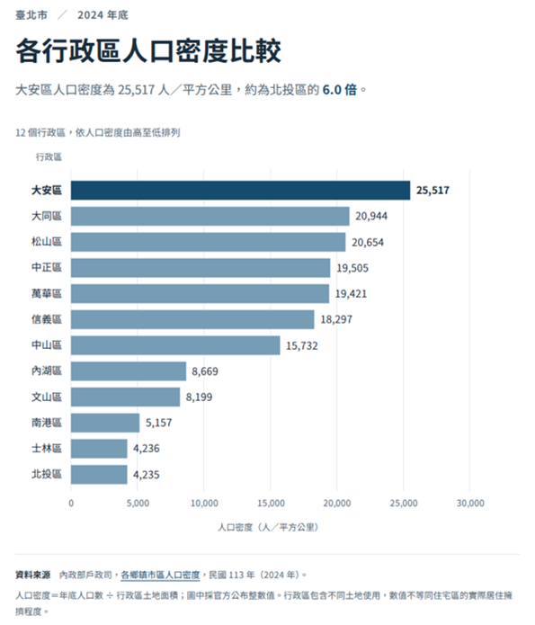
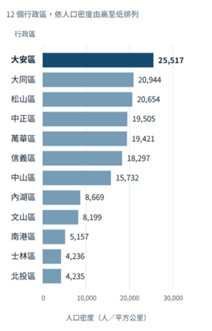

# D3 靜態視覺化專案

**2024 年臺北市各行政區人口密度比較**

**作業題目：Static Visualization Using D3.js**

**GitHub 專案網址：[https://github.com/fju-csie-vis/1151VIS-HW1-414085105--/tree/main](https://github.com/fju-csie-vis/1151VIS-HW1-414085105--/tree/main)**

本專案使用 D3.js 7.9.0 將官方人口資料繪製為水平長條圖，呈現臺北市 12 個行政區的人口密度排名與差距。

## 專案截圖



*圖 1　專案實際執行畫面（視窗寬度 768 px）*

## 資料來源與製作流程

資料採用內政部戶政司「各鄉鎮市區人口密度」的民國 113 年 CSV 檔案。統計時間為 2024 年底，原始檔取得
日期為 2026 年 10 月 13 日。本專案固定使用這一年度，避免日後更新資料改變作業結果。

資料來源　[https://data.gov.tw/dataset/8410](https://data.gov.tw/dataset/8410)

| 原始欄位 | 意義與用途 |
| --- | --- |
| `statistic_yyy` | 統計年，篩選民國 113 年 |
| `site_id` | 區域名稱，篩選臺北市並取得行政區名稱 |
| `people_total` | 年底人口數，單位為人 |
| `area` | 行政區土地面積，單位為平方公里 |
| `population_density` | 官方公布的人口密度，單位為人／平方公里 |

### 資料處理步驟

1. 保存官方原始 CSV，並在 `data/source.json` 記錄來源網址、取得日期與 SHA-256 雜湊，讓資料來源可追溯。

2. 使用 `d3.csvParse()` 解析 CSV，先移除 UTF-8 BOM，再依年份與城市篩選。原始檔中的中文欄位說明列及其他地區會一併排除。

3. 將人口、面積與密度轉成數值，確認 12 個行政區完整且不重複，並檢查數值有效。

4. 依人口密度由高至低排序。圖表直接使用官方公布的整數密度；建置時另核對人口除以面積的結果，避免數值轉換錯誤。

### 資料轉換的核心邏輯

下列為程式流程節錄；完整的欄位檢查與錯誤處理位於 `src/chart.js`。

```javascript
const rows = d3.csvParse(rawCsv);
const data = rows
  .filter(d => d.statistic_yyy === "113" &&
    d.site_id.startsWith("臺北市"))
  .map(d => ({
    district: d.site_id.replace(/^臺北市/, ""),
    density: Number(d.population_density)
  }))
  .sort((a, b) => d3.descending(a.density, b.density));
```

整理後的 12 筆資料另存為 CSV 與 JSON。人口密度反映整個行政區的平均人口集中程度，包含不同土地使用，不能直接視為住宅區的擁擠程度。

## 圖表設計與 D3 實作

水平長條圖讓中文區名維持水平閱讀；所有長條共用從零開始的尺度，讀者可直接比較大小。由高至低排序後，最高與最低值更容易辨識。相同色系代表同一項量測，最高值使用深色並搭配文字註解。

| 視覺元素 | 資料對應 | D3 實作 |
| --- | --- | --- |
| 水平位置與長度 | 人口密度 | `d3.scaleLinear()` |
| 垂直位置 | 排序後的行政區 | `d3.scaleBand()` |
| 長條圖形 | 每區一個矩形 | `data().join("rect")` |
| 座標軸 | 類別名稱與數值刻度 | `axisLeft()` 與 `axisBottom()` |
| 數值標籤 | 官方整數密度 | SVG text 與 `d3.format()` |

### 比例尺與長條繪製

margin 定義留白，width 為容器寬度，bottom 為繪圖區底部。以下節錄顯示資料如何轉為 SVG 矩形的位置與尺寸。

```javascript
const x = d3.scaleLinear()
  .domain([0, d3.max(data, d => d.density)])
  .nice(5)
  .range([margin.left, width - margin.right]);
const y = d3.scaleBand()
  .domain(data.map(d => d.district))
  .range([margin.top, bottom])
  .padding(0.26);

svg.append("g").selectAll("rect")
  .data(data, d => d.district).join("rect")
  .attr("x", x(0))
  .attr("y", d => y(d.district))
  .attr("width", d => x(d.density) - x(0))
  .attr("height", y.bandwidth());
```

### 靜態呈現與版面調整

頁面一次顯示所有行政區、數值、年份、單位及資料來源。未加入動畫或資料篩選；`ResizeObserver` 只在容器尺寸改變時重算座標，不改變資料或排序。窄螢幕減少 X 軸刻度，保留完整區名與數值。SVG 設有 title、desc 與 `role="img"`，讓螢幕閱讀器取得圖表說明；停用 JavaScript 時，頁面另外提供包含 12 區數值的文字表格。

技術參考：

* [D3 比例尺](https://d3js.org/d3-scale)
* [資料綁定](https://d3js.org/d3-selection/joining)
* [座標軸](https://d3js.org/d3-axis)

## 執行與修改操作

### 下載專案

執行下列命令以複製完整的專案至本地端作業系統之檔案系統下。

```bash
git clone https://github.com/fju-csie-vis/1151VIS-HW1-414085105--.git
```

### 主要檔案

| 檔案或目錄 | 用途 |
| --- | --- |
| `data/` | 原始 CSV、清理後資料與來源紀錄 |
| `dist/` 與 `exports/` | 可離線開啟的 HTML，以及靜態 SVG 圖表 |
| `docs/screenshots/` | README 引用的專案截圖 |
| `src/chart.js` | 資料整理、比例尺、SVG 圖形與座標軸 |
| `src/styles.css` | 字型、顏色、間距與列印樣式 |
| `src/template.html` | 頁面結構、標題與資料來源文字 |
| `vendor/` | D3.js、中文字型與第三方授權 |
| `build.mjs` | 產生離線 HTML 與清理後的 CSV 及 JSON |
| `README.MD` | 專案說明、製作流程與操作方式 |

### 修改與重新建置

修改 `src/` 中的來源檔後，在專案根目錄使用 Node.js 18 以上版本執行下列指令。此專案不需要執行 `npm install`。

```bash
cd taipei-density-d3
node build.mjs
```

建置後重新開啟 `index.html` 或 `dist/taipei-density-2024.html`。顏色與字體可在來源檔調整；`exports/` 中的 SVG 是既有快照，修改圖表後需重新匯出。瀏覽器列印功能可將目前頁面另存為 PDF。

### 離線開啟 HTML 檔案

1. 使用瀏覽器開啟 `dist/taipei-density-2024.html`，即可查看圖表。這份檔案已內嵌 D3.js、資料與中文字型，不需網路或本機伺服器。

2. 若使用檔案預覽器看不到圖表，先下載 HTML，再用一般瀏覽器開啟並允許執行 JavaScript。

## 專案驗證與資料觀察

圖 2 為窄螢幕下的實際圖表畫面。長條與座標依可用寬度重新配置，區名和數值仍完整顯示。



*圖 2　窄螢幕實際執行畫面（視窗寬度 375 px）*

| 檢查項目 | 驗證結果 |
| --- | --- |
| 資料完整性 | 12 區完整且唯一，數值與官方資料一致 |
| 數值編碼 | 共同零點，長條寬度比例與人口密度比例一致 |
| 版面 | 320、375、768、1100 px 寬度皆無標籤重疊或裁切 |
| 離線執行 | 單檔 HTML 可正常顯示，執行時無外部網路請求 |

既有版本以 Chromium 驗證；上述畫面與結果對應本 README 說明的同一份專案。

### 資料觀察與限制

大安區為 25,517 人／平方公里，約為北投區 4,235 人／平方公里的 6.0 倍。士林區為 4,236，與北投區僅差 1，因此長條幾乎等長；數值標籤保留了這個差異。本圖可支持同一年度的行政區密度比較。若要解釋住宅擁擠程度、生活品質或差距成因，還需土地使用、住宅與其他背景資料。
